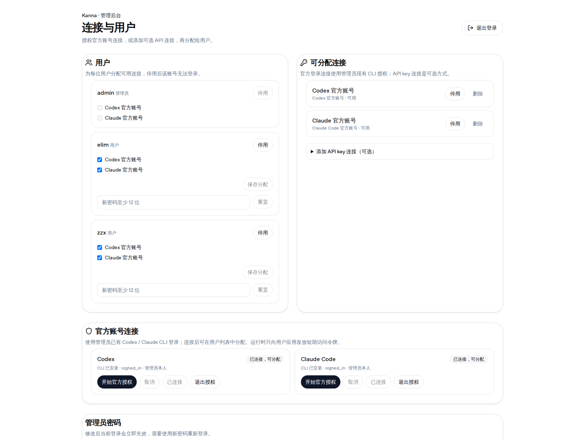
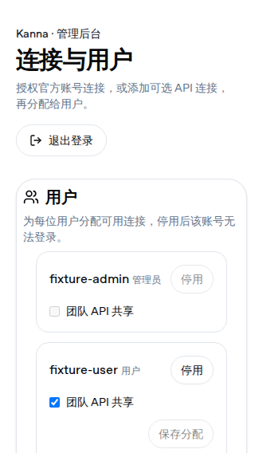
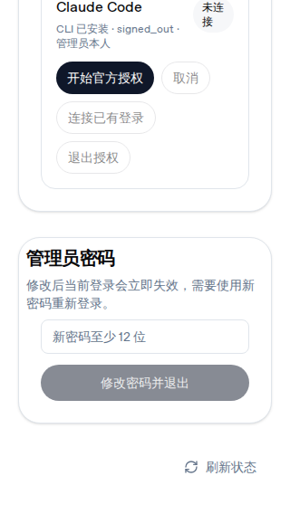

# 网关账号与模型连接

网关把 elim、zzx 两个既有远程工作区放在同一个网页入口后面：用户使用各自的用户名和原工作区密码登录；管理员在独立管理页维护用户和可分配的官方账号连接，也可选配 API key 连接。当前版本只管理这两个已配置工作区，不提供创建新容器或新工作区的功能。网页入口、端口和迁移步骤见[远程工作区指南](remote-workspace.md)。

## 登录与账号管理

网关统一入口为 `http://fnos.zixizhao.top:8444`。登录后，普通用户进入绑定给自己的工作区，只能查看分配给自己的连接名称和状态；管理员进入管理页面，不会因此进入任一普通用户的工作区。账号密码仍由各自用户使用，管理员可停用/恢复用户账号和重置密码。停用或重置密码会立即撤销该账号现有网页登录会话；停用账号不会删除工作区文件和 HOME。

未发送的聊天草稿、聊天标签、差异选择和左右侧栏/终端布局保存在浏览器本机，并按网关用户隔离；同一用户刷新页面后会恢复自己的草稿和布局，不会读到另一个用户的数据。退出登录会清理当前用户在本机保存的这一组状态，不会删除其他用户的浏览器状态或服务器工作区。

首次启用网关时会创建 `admin` 管理员账号，并生成随机初始密码，保存在 `.remote-workspace/secrets/gateway-admin-password`（文件权限 `0600`）。管理员通过独立安全渠道获取该密码后登录。不要把密码内容复制到仓库、部署日志、聊天记录或工单。elim、zzx 的登录密码沿用启用网关前已有的 app 密码；迁移不得重新初始化或重建 manifest。

管理员页面可以启用、停用用户，重置用户密码，为每位用户单独授予或撤销连接。此版本没有动态创建用户的界面。离开团队的用户应先停用，再处理其连接授权；账号状态不会自动清除个人 HOME 或历史项目。

## 管理员官方账号连接

管理员登录管理页后，在“官方账号连接”区域选择 Codex 或 Claude Code。已有管理员 CLI 登录时点“连接已有登录”；尚未登录时，先点“安装 CLI”（如果尚未安装），再点“开始官方授权”，按页面提示打开官方授权页面并完成授权。状态显示已登录后，再点“连接已有登录”。连接成功后，该官方账号连接会出现在可分配连接列表中。CLI 与认证资料保存在网关专用管理员 HOME，管理员可在管理页查看状态、重新授权或退出授权；真实 OAuth 登录和模型可用性须由管理员在部署后的管理页完成，文档和 mock 验证不代表已经登录或验证真实模型调用。

在“用户”区域找到 `elim` 或 `zzx`，勾选要授予的连接并点“保存分配”。用户随后可在 Settings → Providers 的“管理员分配的连接”查看名称和状态，并在聊天中选择对应的 Codex 或 Claude provider。管理员连接只提供对应官方 CLI 登录能力；它不会复制管理员的 HOME、CLI 配置或 refresh token 到用户工作区。管理员侧集中管理官方授权并串行刷新；运行时只向用户应用发放短期访问令牌。管理员退出对应 Codex 或 Claude CLI 授权、停用或删除连接、或撤销该用户分配时，会停止该连接对应的托管 worker，并拒绝后续令牌请求。退出管理网页会话本身不会断开用户服务。

短期访问令牌需要由用户应用进程使用；同一系统 UID 下的其他进程可能读取该进程环境中的 Claude token。已经发给上游并被接收的令牌无法即时收回，仍可能有效至其过期时间。不要把令牌复制到终端、日志、项目文件或工单。

官方个人账号多人使用不等于供应商承诺支持此共享方式。请由管理员和用户自行评估账号使用安排及官方条款：[OpenAI 账号共享政策](https://help.openai.com/en/articles/10471989-openai-account-sharing-policy)；[Claude Code 法律与合规说明](https://code.claude.com/docs/en/legal-and-compliance)。

### 可选 API key 连接

管理员可在“可分配连接”中展开“添加 API key 连接（可选）”，选择 `OpenAI API`（供 Codex 使用）或 `Anthropic API`（供 Claude 使用），填写连接名称和 API key，再点“添加 API 连接”。创建后密钥不会再次显示；需要更换时使用该连接的轮换操作。API key 连接可逐用户授予、停用、重新启用或删除。撤销授权、停用或删除连接会中止对应连接上正在进行的代理请求；删除连接同时移除所有用户的对应授权。API key 是否可用、额度及组织权限由对应服务商账户决定。

## 用户自己的凭据优先级

用户自己的有效 Codex 或 Claude 登录/配置始终优先于管理员分配的连接。若用户自己的凭据失效，Kanna 不会悄悄改用管理员账号或 API key；用户需要自行修复或移除自己的配置。管理员 native 连接本身优先于 API key 连接。native 连接失效时会提示需要重新登录，不会回退到 API key。撤销分配不会删除用户自己的登录态或 API key。

用户自配的 Codex 凭据包括 HOME 中的 `OPENAI_API_KEY`、`CODEX_API_KEY` 或 `.codex/auth.json` 登录凭据。Claude 自配包括 `ANTHROPIC_API_KEY`、`ANTHROPIC_AUTH_TOKEN`、`CLAUDE_CODE_OAUTH_TOKEN`、用户 HOME 的 Claude OAuth 凭据，以及用户 HOME 下 `.claude/settings.json`、`.claude/settings.local.json` 和项目中的 `.claude/settings.json`、`.claude/settings.local.json` 所配置的 `apiKeyHelper`、凭据环境变量或自定义服务商设置。系统检测到凭据存在并据此选择用户自己的配置，但不保证凭据有效。

若要改用管理员分配的连接，先清除该用户自己的凭据，再重新打开聊天：Codex 可删除该用户 HOME 的 `.codex/auth.json` 并移除 Kanna 进程环境中的 `OPENAI_API_KEY` / `CODEX_API_KEY`；Claude 可删除 `.claude/.credentials.json` 或 `.claude/credentials.json`，并从用户级及项目级 `.claude/settings*.json` 移除自己的 Key、`apiKeyHelper` 或自定义服务商配置，同时清除 `ANTHROPIC_API_KEY`、`ANTHROPIC_AUTH_TOKEN`、`CLAUDE_CODE_OAUTH_TOKEN` 等注入给 Kanna 的环境变量。若设置文件还包含其它配置，只删凭据相关项并保留其余字段。

### 用户在自己的工作区登录

用户也可在自己的 Kanna 工作区使用 Settings → Providers → Accounts。若 Codex 或 Claude Code 尚未安装，点对应行的 `Install`；然后点 `Log In`，按页面显示的官方授权 URL 和代码完成授权，回到 Kanna 等待状态更新。登录凭据由官方 CLI 保存在该用户隔离的 HOME 中，不会自动变成管理员连接，也不会授权给其他用户。

若 Codex 用户要配置自己的 API key，可在该用户的终端运行官方 CLI 登录命令并通过标准输入交给 CLI；下面的交互式输入不会回显 key，也不会把 key 写进命令历史：

```sh
read -rsp "OpenAI API key: " OPENAI_API_KEY
printf '\n'
printf '%s' "$OPENAI_API_KEY" | codex login --with-api-key
unset OPENAI_API_KEY
```

登录后凭据由 CLI 写入该用户的 `.codex/auth.json`。Claude Code 用户若使用自己的 Anthropic API key，应把它放在该用户 HOME 的 `~/.claude/settings.json` 的 `env` 中。若文件已存在，请合并字段并保留其它设置，不要覆盖整个文件。仅在某个终端执行 `export ANTHROPIC_API_KEY=...` 不会为之后由 Kanna 启动的代理进程持久配置凭据。

## 管理页面截图



截图通过临时 mock gateway 和浏览器生成，admin、elim、zzx 及 Codex/Claude 登录状态均为合成 fixture。它展示界面布局、native 连接状态和用户分配控件；没有使用真实 CLI、OAuth 登录或凭据，也不代表真实模型调用已验证。

下面两张手机截图展示 320px 宽度下管理页的顶部和滚动到底部状态；用户名、连接名和 provider 状态均为合成 fixture，没有使用真实账号或授权凭据。





## 纯 HTTP 的限制

本次部署使用纯 HTTP。网页、密码、会话令牌、工作区数据和请求内容会以明文经过网络；只应在用户到服务器之间网络路径可信且入口访问范围受控时使用。浏览器会把网页登录令牌保存在当前 origin 的会话存储中；不要在共享设备上保留登录页面。HTTP 下浏览器媒体与大文件传输有额外限制，见远程工作区指南。

统一入口采用一个 hostname 和一个 HTTP 端口，避免同 hostname 下多个工作区端口共享 Cookie 的边界问题；fnOS 的 80、443、8443 与各账号 SSH 端口保持既有配置。公网 DNS、路由器 NAT 和真实模型调用状态须以部署环境实际结果为准；本指南不把它们描述为已验收。

## 数据保存与升级

网关用户、密码哈希、会话哈希、API key 连接凭据和用户授权保存在 gateway 私有状态目录；管理员 Codex/Claude CLI 授权保存在单独的管理员 HOME。网关状态目录和凭据文件应按部署生成的权限限制保存，并纳入受控备份；不要把 `.remote-workspace/`、manifest、`.env`、gateway 状态或任何凭据提交到 Git。备份中可能包含 API key 和管理员登录态，应限制读取并加密保存。

升级前备份整个远程工作区持久状态和生成配置，确认代码与配置对应后再重新生成并更新服务。恢复时还原原状态，不要重新运行 `init` 或清空 gateway 状态目录；否则会失去用户密码、连接授权、管理员 CLI 登录态和远程工作区数据。管理员初始密码文件为 `.remote-workspace/secrets/gateway-admin-password`。启用网关的迁移命令和回滚步骤见远程工作区指南。
